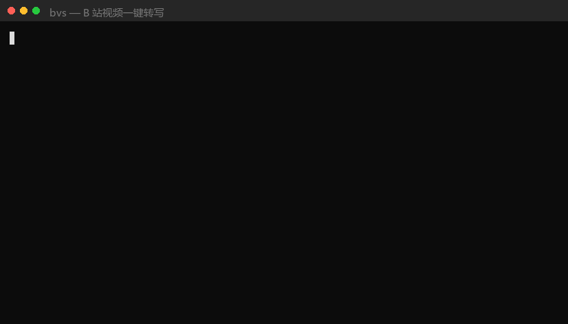

# bilibili-video-summary

[](https://github.com/Erfan817/bilibili-video-summary/actions/workflows/ci.yml)
[](https://www.python.org/)
[](LICENSE)
[](#features)

**One command turns a Bilibili video into a timestamped transcript.** Fully local Whisper
transcription — no API tokens, no audio leaving your machine. Optionally it can also
**read the screen**: slides, tables, handwriting and exam options only exist in the video
frames, and audio transcription will never capture them.

```bash
$ bvs BV1PE411h7b4 --srt
```



[中文](README.md) | **English**

---

## Quick start

```bash
pip install faster-whisper numpy Pillow   # core deps, no ffmpeg needed
pip install -e .                          # installs the `bvs` command

bvs BV1PE411h7b4                          # writes transcript.txt
bvs https://b23.tv/xxxx --srt             # short link + SRT subtitles
bvs BV1xx411c7mD --frames --frames-mode dense   # lectures/slides: include frames
```

A single command runs the whole chain: **parse link → fetch metadata → download audio →
local transcription → homophone correction → write outputs → clean up intermediates**.
No agent required; `transcript.txt` lands on disk.

---

## Three ways to use it, one core

| Mode | Best for | Entry point |
|---|---|---|
| **One-shot CLI** | You just want a transcript, without an agent | `bvs <link>` |
| **Agent skill** | Conclusion-first structured notes + vision | [`SKILL.md`](SKILL.md) |
| **MCP server** | Let your IDE / agent call this capability directly | [`mcp_server.py`](mcp_server.py) |

> Division of labour: **the CLI produces the raw material** (transcript / SRT / key frames /
> metadata); **the agent produces the conclusions** (distilling, writing, reading frames).
> That is the watershed from "skill" to "tool" — without an agent, the chain still closes.

---

## What it does that similar tools don't

| Capability | Detail |
|---|---|
| **Bilibili AI-subtitle fast path** | With a cookie and AI subtitles present, it fetches subtitles and finishes in seconds, skipping Whisper entirely; otherwise it falls back to local transcription |
| **Multi-platform (yt-dlp backend)** | Non-Bilibili links (YouTube, …) go through yt-dlp, sharing the same transcription/correction/output path |
| **Unlocks higher video quality** | `--cookie` lifts the anonymous 480p ceiling so small text on slides stays legible |
| **Crowdsourced correction table** | Rules live in `corrections.json`, graded by confidence — PRs welcome (see below) |
| **Correction without an agent** | `high` entries are auto-replaced; `context` entries are **flagged, never replaced**, and listed for review |
| **Traditional→Simplified normalization** | Whisper mixes in Traditional forms («打電話 / 報喜不報憂»); `zhconv` normalizes them |
| **No duplicated work** | Existing outputs are skipped (`--force` to redo); `--json` for downstream tools / MCP |

---

## Installation

### Dependencies

```bash
pip install faster-whisper numpy Pillow
pip install -e .          # gives you the global `bvs` command
```

- Python 3.10+
- **No ffmpeg needed** — faster-whisper ships PyAV for decoding; neither transcription nor
  frame extraction requires it
- `zhconv` (Traditional→Simplified normalization, installed with the core deps)
- Optional: `pip install yt-dlp` (multi-platform), `pip install "mcp[cli]"` (MCP server)

### Model

Point an environment variable at a faster-whisper model directory already on disk:

```bash
export WHISPER_MODEL_DIR=/path/to/faster-whisper-small
```

If unset it falls back to the model name `small` (downloaded by faster-whisper).

> ⚠️ **Windows note**: HuggingFace auto-download produces 0-byte symlinks and ctranslate2
> then fails with `File model.bin is incomplete`. Download the model to disk manually first
> (see [Gotchas](#gotchas)).

---

## CLI reference

```
bvs <BV id | av id | bilibili URL | b23.tv short link | other platform URL> [options]
```

| Option | Default | Description |
|---|---|---|
| `--p N` | 1 | Part index for multi-part videos |
| `-o, --out DIR` | `./outputs/<title>` | Output directory |
| `--model NAME\|DIR` | `$WHISPER_MODEL_DIR` or `small` | Model name or local directory |
| `--lang zh\|en\|auto` | `zh` | `auto` lets the model detect the language |
| `--topic KEYWORDS` | video title | Fed to `initial_prompt`; cuts domain-term errors sharply |
| `--cookie FILE\|STR` | — | Path to cookies.txt, or a `SESSDATA=..; ..` string — enables the subtitle fast path and HD streams |
| `--no-subtitle` | off | Disable the subtitle fast path; force local transcription |
| `--srt` | off | Also write SRT subtitles |
| `--frames` | off | Frame mode: download the video stream and extract key frames |
| `--frames-mode scene\|dense` | `scene` | `scene` for talks, **`dense` is required for slides/PPT** |
| `--dense-interval S` / `--max-frames N` | 8 / 60 | Dense sampling interval / candidate frame cap |
| `--no-correct` | off | Skip homophone correction |
| `--no-simplify` | off | Skip Traditional→Simplified normalization (on by default with zhconv) |
| `--keep` | off | Keep intermediates (deleted after the run by default) |
| `--force` | off | Ignore existing outputs; re-download and re-transcribe |
| `--json` | off | Machine-readable result (for scripts / MCP) |
| `--threads N` | half the CPU cores | Whisper thread count |

### Outputs

```
outputs/<title>/
├── transcript.txt      # timestamped transcript
├── transcript.srt      # SRT subtitles (--srt)
├── summary.md          # metadata + transcript reference + correction review list
├── summary.json        # machine-readable result
├── frames/             # key frames (--frames)
└── frames_index.txt    # frame timestamps + change metrics
```

See [example output](examples/README.md).

---

## Pipeline

```
Bilibili link ─┬─→ cookie + AI subtitles available? ─→ fetch subtitles (seconds) ─┐
               │                                                                  │
               └─→ download audio ─→ local Whisper ─→ homophone fix ──────────────┼─→ transcript.txt / .srt
                                                                                  │   summary.md / summary.json
   with --frames: download video ─→ extract frames ─→ frames/ + frames_index.txt ──┘
```

### Should you enable frame mode?

| Video type | Visual information | Recommendation |
|---|---|---|
| Lectures / slides / blackboard | Very high | **Yes** (`--frames-mode dense`) |
| Code demos / IDE work | High | **Yes** |
| Charts, data, derivations | High | **Yes** |
| Pure interviews / podcasts | Low | No — wasted compute |
| Screen-only, no narration | — | **Yes** — the screen is the only source |

---

## Homophone correction (PRs welcome)

Whisper's Chinese misrecognitions are strikingly regular. The rules live in
[`bvs_core/corrections.json`](bvs_core/corrections.json); **adding an entry is a PR**:

```json
{
  "from": ["维德根斯坦", "维德克斯坦", "维德根兰"],
  "to": "维特根斯坦",
  "confidence": "high",
  "note": "philosopher"
}
```

### Why two confidence levels

Blind replacement causes damage — **「奇异」 is legitimately correct in a maths context**.
So:

| confidence | Behaviour | Example |
|---|---|---|
| `high` | **Auto-replaced** (stable multi-character misrecognitions) | 维德根斯坦 → 维特根斯坦 |
| `context` | **Flagged only, never replaced**; listed line by line for review | 奇异 → 歧义 (needs human/AI judgement) |

The CLI prints the review list, handing the "looks right, is wrong" risk back to a human:

```
wrote transcript.txt.corrected  (auto-fixed 2 lines, context-review 1 lines)
  L1  加瓦->Java x1
  L3  维德根斯坦->维特根斯坦 x1

-- context review list (not auto-replaced; judge line by line) --
  L2 [奇异->歧义] [00:00:05] 这个矩阵是奇异的大家别担心
```

> Standalone use: `python -m bvs_core.correct transcript.txt`
>
> **Before submitting an entry**: only put stable, non-damaging multi-character forms under
> `high`; anything uncertain belongs under `context`.

---

## Benchmarks

8-thread CPU / int8 quantization / `small` model:

### Transcription time

| Audio length | Model load | Transcribe | Total | 30216 audio track |
|---|---|---|---|---|
| 9 min | ~10s | 60–90s | ~2 min | ~3 MB |
| 4 min | ~1.3s | 33s | ~35s | 1.2 MB |
| 55 min | ~10s | ~7.5 min | ~8 min | 25.7 MB |

### Frame extraction (lecture-style, 20-minute video)

| Item | Value |
|---|---|
| Video stream size | 12.4 MB (480p; static slides compress extremely well) |
| Decode | 36425 frames in ~30s |
| Dense extraction | 8s interval → 70 candidates, 22 of them real content changes |
| Frame size | JPEG (q85), ~40–110 KB |

> **Legibility conclusion**: 480p (852×480) is **perfectly sufficient** for slide decks —
> table body text and hand-written annotations are both clearly readable. No need to fight
> with cookies just for 1080p.

---

## Gotchas

1. **Pick the video stream by resolution, not by lowest bandwidth** — a static slide deck at
   480p is only 85 kbps, barely smaller than 360p, but resolution decides whether small text
   is readable.
2. **Frame extraction needs two metrics** — MAE alone drags in every facial micro-expression
   (measured: 182 frames in 316 seconds, i.e. no filtering at all). Adding "fraction of
   changed pixels" brought it down to 71.
3. **Lecture material requires dense mode** — when slides appear line by line the whole-screen
   change is tiny; scene detection thresholds miss all of it.
4. **Big change ≠ much information** — transitions and blank interstitials also trigger high
   MAE; a human/vision pass is still needed.
5. **Truncated files raise decode errors** (`InvalidDataError`) — wrap the decode loop in
   try/except to keep the frames already extracted.
6. **Always close the PyAV container** — otherwise Windows keeps the `video.m4s` handle open,
   cleanup fails silently, and hundreds of MB are left behind.
7. **Frames catch hard ASR errors** — a real run transcribed the POP3 port as "120" while the
   screen said **110**. Numbers and abbreviations cannot be recovered from audio.
8. **Never wrap a background transcription in `| tail`** — pipe buffering makes it look hung.
   Check progress with `wc -l transcript.txt`.
9. **HF model downloads produce 0-byte symlinks** — download to disk manually
   (`HF_HUB_DISABLE_XET=1` + `HF_ENDPOINT=https://hf-mirror.com`).
10. **Whisper mixes Traditional Chinese into Mandarin output** (observed 「打電話 / 報喜不報憂」)
    — asking for Simplified Chinese in `initial_prompt` alone is **not enough**; the
    deterministic fix is `zhconv` (pure Python, tens of KB). Once installed, `bvs`
    automatically normalizes Traditional → Simplified, and warns you to install it
    otherwise.
11. **Anonymous access caps at 480p and returns empty subtitle arrays** — both need a cookie
    (`--cookie`).
12. **Bilibili's search API easily returns 412** — anti-crawling; `bili.py` translates that
    412 into plain language and suggests using a cookie.

---

## Why not use Bilibili's subtitle API

The `subtitle.subtitles` field from `api.bilibili.com/x/player/v2` is **almost always an empty
array when logged out** (`need_login_subtitle: true`) — AI subtitles require a login cookie. The
comment API now also requires wbi signing.

So the default path is **download the audio and run local ASR**, which is the most robust; the
subtitle endpoint is only used as a fast path when a cookie is supplied.

---

## Project layout

```
bilibili-video-summary/
├── bvs.py                       # one-shot CLI entry point
├── bvs_core/
│   ├── bili.py                  # link parsing / metadata / stream picking / cookie / download / subtitles
│   ├── transcribe.py            # local Whisper transcription (+ SRT)
│   ├── frames.py                # frame extraction (scene / dense)
│   ├── correct.py               # homophone correction engine (high / context)
│   ├── corrections.json         # crowdsourced correction table (PRs welcome)
│   └── pipeline.py              # full orchestration + CLI arguments
├── scripts/                     # skill scripts (thin wrappers, see SKILL.md)
│   ├── fetch_media.py
│   ├── transcribe.py
│   └── extract_frames.py
├── mcp_server.py                # MCP server (optional)
├── tools/make_demo_gif.py       # regenerates the README GIF (reproducible, no screen recording)
├── tests/                       # unit tests (stdlib only, no network)
├── examples/                    # example output
├── SKILL.md                     # full agent-skill workflow / parameters / benchmarks
└── assets/demo.gif              # README demo GIF
```

### Running the tests

```bash
python -m unittest discover -s tests -v
```

---

## Related projects

Survey of similar tools (2026-09):

- [JefferyHcool/BiliNote](https://github.com/JefferyHcool/BiliNote) — most-starred project in the video-notes space
- [ysyecust/lecture-to-notes](https://github.com/ysyecust/lecture-to-notes) — Claude Code skill, dense sampling + panel geometry measurement
- [drpwchen/lecture-to-notes](https://github.com/drpwchen/lecture-to-notes) — six-stage pipeline + synced HTML viewer
- [asdhabdua/bilibili-video-notes-skill](https://github.com/asdhabdua/bilibili-video-notes-skill) — frames + OCR + visual scoring → DOCX

---

## License

MIT
